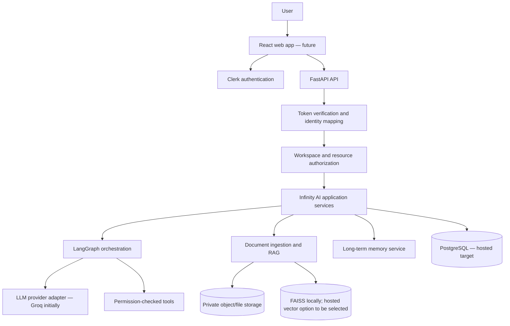

# Infinity AI — Long-Term Plan

**Document status:** Architecture direction agreed; detailed implementation sequencing remains to be validated against the existing codebase.  
**Last updated:** 2026-10-22  
**Related document:** [`SMALL_STEPS_PLAN.md`](SMALL_STEPS_PLAN.md)  
**Original roadmap:** [`PROJECT_PLAN.md`](PROJECT_PLAN.md)

---

## 1. Product vision

Evolve Infinity AI from its current working prototype into a reliable, secure, multi-user AI SaaS that supports conversations, document-based question answering, tools, long-term memory, and eventually multimodal and more autonomous workflows.

The product should be developed locally first and hosted later. The architecture should make the transition practical without building a distributed system before it is needed.

### Product principles

1. **Reliability before feature count.** Every important capability should have repeatable tests and clear failure behavior.
2. **Local-first, cloud-ready.** Make development easy on a local machine while keeping application logic and infrastructure boundaries clean.
3. **Modular monolith first.** Keep a single application with well-separated modules. Split services only when measured scale or operational needs justify it.
4. **Security is part of the design.** Identity, workspace ownership, authorization, document retrieval, memory, and tool execution must all enforce the same access boundaries.
5. **Evaluate changes.** Measure chat behavior, RAG quality, agent/tool reliability, latency, and usage rather than adding techniques without evidence.
6. **Preserve working code.** Audit before refactoring; make small changes and test them independently.

## 2. Decisions already agreed

| Topic | Decision | Implementation status |
|---|---|---|
| Product audience | Public, multi-user SaaS | Direction agreed; not launched |
| Development and launch | Develop locally, host later | Direction agreed |
| Initial workspace model | One private workspace per signup | Model agreed; not implemented/verified |
| Future teams | Prepare a workspace-membership model now; add shared team workspaces later | Direction agreed |
| Authentication approach | Managed authentication provider | Agreed |
| Authentication provider | Clerk is the selected v1 provider, subject to a small proof of concept before deep integration | Selected; not integrated |
| Authentication priority | Polished React authentication experience and developer experience | Agreed |
| Application database | Keep it independent of Clerk; PostgreSQL is the target for hosted multi-user application data | Target direction; migration not done |
| Current frontend | Keep Streamlit during initial audit and stabilization; build React later | Direction agreed |
| Future API boundary | FastAPI for the hosted React-to-backend interface | Target direction; existing code must be audited first |
| Agent orchestration | Keep LangGraph | Existing project plan marks this as implemented; verify during audit |
| Initial inference provider | Keep Groq initially behind a provider boundary where practical | Existing project uses Groq; verify during audit |
| Current vector search | Keep local FAISS during the initial phase | Existing project plan marks this as implemented; verify during audit |
| Future vector storage | Compare PostgreSQL/pgvector with a dedicated vector store before choosing hosted infrastructure | Open decision |
| Architecture style | Modular monolith before microservices | Agreed recommendation |
| Implementation style | Brainstorm and agree on design first, then implement phase by phase | Agreed working process |

## 3. Current baseline from the original project plan

The original `PROJECT_PLAN.md` marks these Phase 1 items as completed:

- LangGraph-based state management.
- LLM integration through Groq and basic tool calling.
- Per-thread PDF RAG using FAISS.
- Streamlit frontend and thread persistence.
- Basic Search, Stocks, and Calculator tools.

These items are **reported as completed in the plan, not yet independently verified in the current source code**. The first implementation step is a read-only audit.

The original roadmap also proposes support for TXT, DOCX, and CSV files; Notion and Google Drive; hybrid search; reranking; query expansion; long-term memory; Markdown and code rendering; a document manager; authentication; evaluation and observability; async tool execution; a REST API; third-party integrations; and bounded multi-step autonomous agents.

## 4. Target architecture

During the early phases, Streamlit remains the current interface. The architecture diagram describes the eventual target, not the current repository state.

### Architecture boundaries

- **Frontend:** presentation, input handling, rendering, and authentication UI. It is not a security boundary.
- **Authentication provider (Clerk):** identity, sign-in/sign-up, session lifecycle, and supported authentication flows.
- **FastAPI:** request validation, token verification, internal identity resolution, authorization, and API contracts.
- **Application services:** chat, thread management, document processing, memory, and tool-use cases. Keep business logic independent of UI components.
- **LangGraph:** coordinates agent workflows and execution state; it does not decide whether the caller has permission to access data.
- **Database:** owns Infinity AI's application records and relationships, not Clerk's authentication flows.
- **Storage and retrieval:** original files, extracted chunks, and embeddings must preserve workspace access boundaries.
- **Observability/evaluation:** logs, usage measurement, traces where useful, and repeatable quality tests.

## 5. Identity and tenancy model

### Proposed core entities

| Entity | Responsibility |
|---|---|
| `users` | Internal Infinity AI user ID and application status |
| `auth_identities` | Maps `(provider, provider_subject)` to an internal user ID |
| `workspaces` | Private or future shared resource boundary |
| `workspace_memberships` | Membership and role within a workspace |
| `conversations` | Chat metadata, workspace scope, creator, and mode |
| `messages` | User-visible conversation transcript |
| `documents` | Uploaded file metadata, owner/workspace, storage key, and processing status |
| `document_chunks` | Extracted text chunks and traceable source metadata |
| `memory_items` | Explicitly scoped user or workspace memories |
| `agent_runs` | Agent execution status, timing, and usage metadata |
| `tool_invocations` | Optional audit records for tool executions and approvals |

These are proposed entities. Final field names, keys, constraints, and migrations must be decided after inspecting the current schema and code.

### Identity rules

- Keep a stable internal `users.id` independent of Clerk's subject ID.
- Make `(provider, provider_subject)` unique in `auth_identities`.
- Do not use email as a permanent primary identity key.
- Create the initial private workspace idempotently after first successful authentication or through a controlled account-provisioning flow.
- Keep membership records from day one so future teams do not require a new ownership model.
- Do not enable shared team workspaces until team roles, invitations, and membership ownership are explicitly designed.
- Do not enable Clerk Organizations in v1 without a later decision about the source of truth for memberships.

## 6. Authentication and authorization

### Authentication

- Use Clerk's React SDK/components when the React frontend is introduced.
- Validate Clerk tokens on the backend using the official supported server-side SDK or a correctly implemented token-verification flow.
- Validate signature and relevant claims, including expiration and expected issuer/audience as appropriate for the configured token.
- Keep secret keys on the server and out of source control, client-side bundles, and logs.
- Use separate development and production credentials and allowed origins.
- Keep provider-specific behavior inside a narrow authentication adapter/module.

### Authorization

A valid login is not permission to every resource. Before accessing a conversation, file, vector chunk, memory, agent run, or tool, the backend must verify access to the relevant workspace/resource.

- Never trust a client-supplied user ID or workspace ID as proof of authorization.
- Never treat a thread ID or unguessable resource ID as a permission check.
- Derive the authenticated identity from a verified token and resolve it to an internal user record.
- Centralize workspace/resource access checks and apply them in every data-access path.
- Carry trusted workspace context into background jobs and revalidate that the target resource remains permitted.
- Test cross-user and cross-workspace access explicitly.
- Evaluate PostgreSQL Row-Level Security for defense in depth after the application authorization model is clear. Configure restricted database roles and test using the same roles as the app; RLS does not replace application-level authorization.

## 7. Conversation, checkpoint, and memory design

- Treat the user-visible conversation/message records separately from LangGraph checkpoint state.
- Map a conversation to a server-managed LangGraph thread ID after the caller is authorized.
- Never accept a client-supplied LangGraph thread ID as proof of access.
- Define handling for a partial failure where a message write succeeds but an agent run/checkpoint does not, including idempotency and retries.
- Keep long-term memory separate from per-thread checkpoints and document knowledge.
- Give memories an explicit user or workspace scope; a memory must not silently become shared.
- Define review, update, expiration, and deletion behavior for saved memories.

## 8. Documents and RAG

### Initial behavior

- Audit the existing per-thread PDF/FAISS workflow before changing it.
- Establish tests for text extraction, chunking, metadata, retrieval, source references, and failures.
- Give documents explicit ownership, processing status, and deletion behavior.
- Store original uploads privately; persist storage keys rather than public permanent URLs.

### Planned progression

1. Stabilize current PDF ingestion and retrieval.
2. Add TXT, DOCX, and CSV support with format-specific tests.
3. Add a document manager with status, source metadata, and deletion.
4. Measure baseline retrieval quality.
5. Evaluate hybrid keyword + semantic search.
6. Evaluate reranking against the baseline.
7. Add query expansion only where evaluation shows benefit.
8. Consider Notion and Google Drive connectors after the local document pipeline and permission model are sound.
9. Evaluate FAISS migration options for hosted use; compare pgvector with a dedicated vector database using actual workload and isolation requirements.

All retrieved chunks must be filtered to resources the current user is allowed to access before the content is sent to the LLM.

## 9. Reliability, evaluation, and observability

Build an evaluation set early and keep it versioned. Begin with roughly 30–50 representative questions and tasks, expanding it as real failure cases are found. The set should include ordinary chat, multi-turn context, tool selection, document questions, citations, failure cases, and workspace-isolation checks.

Measure where relevant:

- Correctness and answer relevance.
- RAG retrieval quality, source attribution, and faithfulness.
- Tool selection and tool execution success.
- Failure/retry rates and agent-loop bounds.
- Latency and token/usage costs.
- Tenant isolation and authorization failures.

Use structured logs and local test/evaluation workflows. LangSmith may be used for tracing when useful, but core development and tests should not require paid hosted tracing. Do not log secrets or unnecessary private document/chat content.

## 10. Security, cost, and operations

Before public launch, plan for:

- Rate limits and usage quotas by user/workspace, plus global service limits.
- Upload size/type limits, request limits, timeouts, bounded retries, and bounded agent steps.
- Permission checks for every tool that accesses data or performs actions; require user confirmation for consequential actions.
- Prompt-injection-aware handling of uploaded documents and tool results.
- Database migrations, backups, and tested restoration.
- Account deletion and defined data-retention/deletion behavior for conversations, files, checkpoints, vectors, and memories.
- HTTPS, secret management, least-privilege service credentials, dependency updates, and monitoring.
- Error reporting, health checks, and an incident/recovery procedure.
- Usage measurements that can inform future free/paid plans.

## 11. Long-term phases and exit conditions

### Phase 0 — Product and architecture definition
**Goal:** confirm product requirements, boundaries, and measurable success criteria.  
**Exit:** decisions and open questions are documented; initial evaluation scenarios exist.

### Phase 1 — Read-only audit and current-state baseline
**Goal:** understand current files, dependencies, flows, storage, graph state, tools, and existing behavior without editing code.  
**Exit:** current architecture map, known issues, and a prioritized risk list are reviewed.

### Phase 2 — Core reliability and modular boundaries
**Goal:** stabilize chat/thread persistence, errors, tool execution, configuration, and testability.  
**Exit:** baseline tests are repeatable; critical failures have controlled behavior; business logic is not unnecessarily tied to the UI.

### Phase 3 — SaaS identity and data boundaries
**Goal:** integrate Clerk, internal identity mapping, private workspaces, PostgreSQL migrations, FastAPI access boundaries, and authorization tests in small steps.  
**Exit:** authentication works locally and cross-user/workspace tests pass before public exposure.

### Phase 4 — Document management and RAG quality
**Goal:** strengthen ingestion, metadata, citations, deletion, retrieval evaluation, and additional formats.  
**Exit:** document lifecycle is testable end to end and retrieval changes show measured results.

### Phase 5 — Controlled long-term memory
**Goal:** implement user/workspace-scoped memory, clear save/retrieval rules, and memory controls.  
**Exit:** cross-thread memory behavior and deletion/expiration pass tests.

### Phase 6 — Product UI and multimodal workflows
**Goal:** introduce React UI, Markdown/code rendering, Coding and Normal modes, document management, and selected multimodal capabilities.  
**Exit:** priority user flows work through the frontend and backend APIs.

### Phase 7 — Production readiness
**Goal:** usage limits, observability, deployment, backups, deletion operations, security review, and recovery checks.  
**Exit:** documented launch checklist and tested operational procedures.

### Phase 8 — Integrations and bounded autonomy
**Goal:** REST/API consumers, selected Slack/Discord/Email or knowledge-base integrations, asynchronous tools, and plan-and-execute workflows.  
**Exit:** each integration has permission checks, limits, monitoring, and task-level tests.

## 12. Open decisions — do not assume they are finalized

- Exact hosting provider and deployment topology.
- Exact PostgreSQL hosting and migration timing.
- Whether to use PostgreSQL RLS and the final database-role design.
- Whether hosted vectors should use pgvector or a separate vector service.
- File/object storage provider and deletion guarantees.
- Whether to use Clerk Organizations for future team workspaces.
- Final workspace roles, invitations, and organization administration behavior.
- Subscription/billing model and usage allowances.
- Which multimodal inputs and outputs are supported in v1.
- Which external connectors are worth implementing first.
- Final production SLOs, retention periods, and capacity targets.

## 13. Working agreement

- Start with a read-only audit; do not rewrite code before understanding the current implementation.
- Discuss significant architecture decisions before implementation.
- Make one small change at a time, explain its purpose and trade-offs, and run focused tests.
- Mark a task complete only after its acceptance criteria pass.
- Keep `LONGTERM_PLAN.md` as the direction and decision record; use `SMALL_STEPS_PLAN.md` as the execution checklist.
